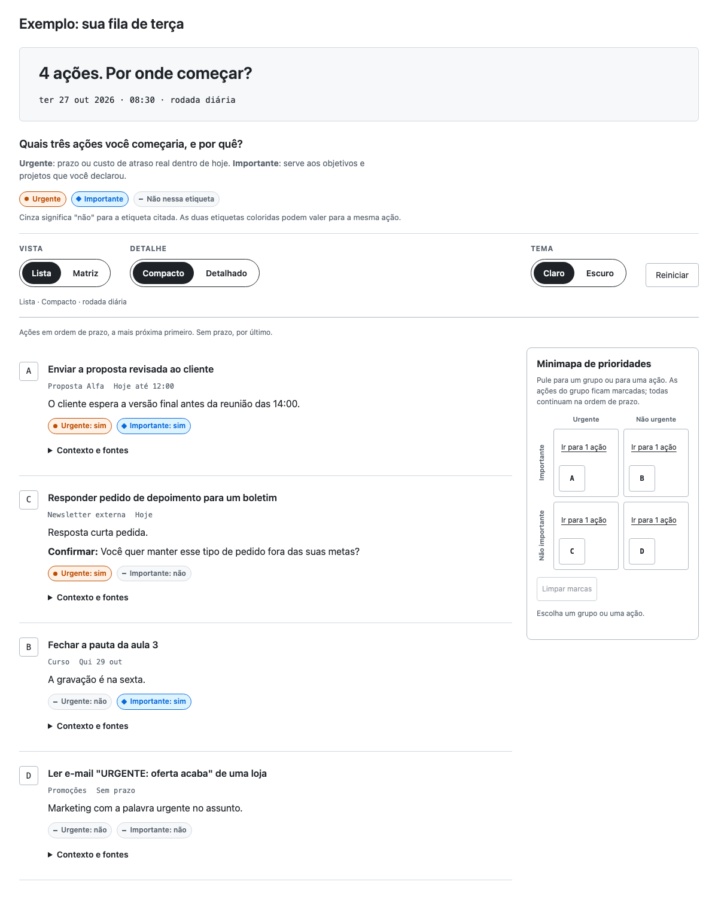

# Fila de Prioridades

**Pare de decidir o seu dia pelo assunto em maiúsculas. Toda manhã, uma matriz Urgente × Importante feita com os seus e-mails e a sua agenda de verdade.**

[Página de apresentação](https://mscreative.systems/arsenal/fila-de-prioridades) • [Veja como fica](#veja-como-fica) • [Instalar](#instalar) • [Como usar](#como-usar) • [O que foi testado](#o-que-foi-testado) • [Comunidade](#comunidade-gratuita)

---

Uma skill para o Claude que lê o seu Gmail e o seu Google Calendar, separa o que você precisa decidir em quatro quadrantes (fazer agora, agendar, delegar, eliminar) e gera um arquivo HTML com Lista, Matriz e minimapa, em tema claro e escuro. Na primeira vez ela faz uma entrevista curta, uma pergunta por vez, roda uma prévia com os seus dados reais e agenda a rodada diária ou semanal.

## Veja como fica



Esse exemplo usa dados inventados. Repare na ação D: um e-mail com "URGENTE" no assunto, mas sem prazo real, cai em "nem urgente nem importante". Você pode [abrir o exemplo no navegador](examples/exemplo-matriz.html) (baixe o arquivo e abra) e mexer nas vistas, sem instalar nada.

## Antes e depois

| Antes | Depois |
|-------|--------|
| Você abre a caixa de entrada e decide pelo que parece urgente: o assunto em maiúsculas, o último e-mail que chegou. | Você abre um arquivo com as ações em quatro quadrantes, cada uma com prazo, motivo e o trecho do e-mail ou do evento que a sustenta. |

A skill não confia na palavra "urgente". Urgente é o que tem prazo ou custo de atraso real dentro da rodada. Importante é o que serve aos projetos que você declarou na entrevista. Quando ela fica em dúvida, marca a ação com "Confirmar" em vez de chutar.

## Instalar

Precisa de Python 3 no computador (o script que monta a página). Copie a pasta da skill para a pasta de skills do seu Claude:

```bash
git clone https://github.com/1marcelserrano/fila-de-prioridades.git
cp -r fila-de-prioridades/skills/fila-de-prioridades ~/.claude/skills/
```

## Como usar

1. **Conecte** o Gmail e o Google Calendar ao Claude (Claude Code ou Claude Desktop).
2. **Abra uma conversa nova** e peça: "configurar minha fila".
3. **Responda às perguntas**, uma por vez (a tabela abaixo mostra quais são). A skill faz uma prévia com os seus dados reais e você diz se está certa.
4. **Receba a matriz** no horário que escolheu e abra o arquivo no navegador. Se uma classificação estiver errada, diga "ajustar minha fila" e ela transforma a sua correção numa regra.

Frases que ativam a skill: "fila de prioridades", "matriz da manhã", "matriz urgente e importante", "resumo da manhã dos meus e-mails", "o que resolver primeiro". Em linguagem natural também funciona: "me mostra o que eu preciso resolver primeiro hoje".

## O que ela pergunta

| Pergunta | Para quê |
|----------|----------|
| De onde saem as coisas que você decide (Gmail, Calendar, Drive, texto colado)? | Define as fontes |
| De qual conta vem cada fonte? | Evita misturar conta de trabalho e pessoal |
| Itens de saúde, terapia, família e finanças pessoais entram? | Respeita o que é sensível; o padrão é deixar de fora |
| Quais pastas, agendas e filtros valem? | Reduz ruído (promoções, newsletters) |
| Quais são os 3 a 5 projetos que mais importam agora? | Define o que é "importante" |
| Há pessoas ou pedidos que sempre são urgentes? | Ajusta a regra à sua realidade |
| Diária ou semanal, e a que horas? | Agenda a rodada |

## O que você recebe

- Uma matriz com as ações em ordem de prazo, cada uma com a etiqueta Urgente e Importante, o motivo e a fonte.
- As 3 ações com que começar, ditas na resposta do Claude.
- Um aviso claro quando uma fonte falha, em vez de uma matriz vazia fingindo que está tudo bem.

## Para quem é

Para quem decide muita coisa por e-mail e agenda, vive com a caixa de entrada cheia e quer parar de reagir ao último pedido que chegou. Não é um gerenciador de tarefas: ela não cria tarefas, só mostra o que você já tem de decidir.

## O que ela faz e o que não faz

| Faz | Não faz |
|-----|---------|
| Lê Gmail e Calendar e monta a matriz com prazo, motivo e fonte | Não envia, apaga, arquiva nem marca e-mails, por regra da skill |
| Agenda a rodada diária ou semanal | Não promete rodar sozinha com o computador desligado, a não ser no modo nuvem, opcional e ainda em validação |
| Avisa quando uma fonte falha em vez de gerar uma matriz vazia | Não troca o seu julgamento: classifica pelo mais provável e deixa a dúvida visível |
| Trata pedidos de pagamento de remetente desconhecido como possível golpe | Não abre nem reproduz links de e-mails |

## O que foi testado

Sem rodeio, para você saber no que está pisando:

- Rodada real no Claude Desktop, com Gmail e Calendar de uma conta de verdade, em execução manual: funcionou.
- Rotina de teste na nuvem, de uso único: leu Gmail e Calendar, gerou a página e fez o commit.
- **Ainda não provado:** o disparo recorrente por horário e o setup completo por quem não é o autor.
- **Atenção:** "somente leitura" é uma regra da skill e do prompt, não um bloqueio técnico. A tarefa agendada enxerga as ferramentas de enviar e apagar e-mail. Leia o item sobre isso no arquivo `skills/fila-de-prioridades/references/conectores.md` antes de agendar.

## Fontes

- Zhu, M., Yang, Y. e Hsee, C. K. (2018). The Mere Urgency Effect. *Journal of Consumer Research*, 45(3), 673 a 690. As pessoas tendem a escolher a tarefa urgente em vez da importante, mesmo quando a urgente rende menos. A regra da skill de não tratar a palavra "urgente" como prazo é uma aplicação nossa, por precaução; o estudo trata de prazos curtos, não de assuntos de e-mail.
- A matriz de quatro quadrantes (fazer, agendar, delegar, eliminar) é o método popularizado por Stephen Covey. A frase atribuída a Eisenhower circula com redações diferentes e sem origem confirmada, e a skill não depende dela.

## Comunidade gratuita

Esta skill é um presente para quem quer parar de decidir o dia pelo susto. Se você quer construir skills como essa, e conversar com quem está fazendo o mesmo, entre na comunidade gratuita:

**[Entrar na comunidade no Skool](https://www.skool.com/marcel-1662/about)**

## Origem

Baseada no jig "Morning inbox", do Brief 01 do d.AI, de Marcel Serrano (matriz Urgente × Importante, vistas Lista e Matriz, minimapa). O visual segue o design system Primer, do GitHub.

## Contribuir

Pull requests são bem-vindos. Veja o [CONTRIBUTING.md](./CONTRIBUTING.md).

## Licença

MIT. Veja o [LICENSE](./LICENSE).

---

<sub>Forged at [MSCREATIVE.SYSTEMS™](https://mscreative.systems), Barcelona</sub>
